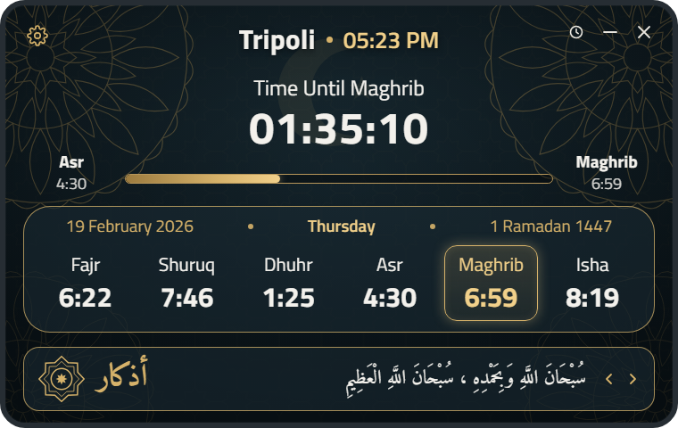
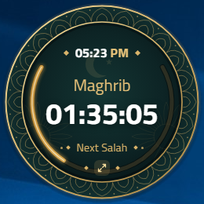
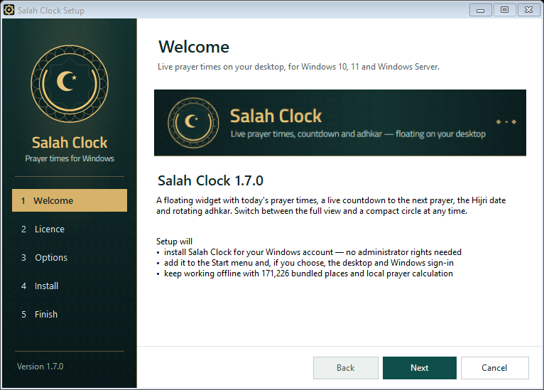

# Salah Clock

A floating prayer-times widget for Windows, with:
- today's prayer times
- a live countdown to the next prayer
- the Hijri date
- rotating adhkar

It stays on top of your other windows, lives in the system tray and keeps working offline.

  
  &nbsp;
  

## Download

| | File | |
|---|---|---|
| **Installer** (recommended) | **[Salah-Clock-1.7.0-setup.exe](https://github.com/AbdUllahMohammadFarouk/salah-clock-releases/releases/latest/download/Salah-Clock-1.7.0-setup.exe)** | 143 MB |
| Portable (no install) | [Salah-Clock-1.7.0-portable.exe](https://github.com/AbdUllahMohammadFarouk/salah-clock-releases/releases/latest/download/Salah-Clock-1.7.0-portable.exe) | 91 MB |

All versions and release notes are on the [Releases](https://github.com/AbdUllahMohammadFarouk/salah-clock-releases/releases) page.

**Requirements:** Windows 10, Windows 11, or Windows Server 2016 or later (64-bit). No administrator rights are needed.

## Install

1. Download **Salah-Clock-1.7.0-setup.exe** and run it.
2. Follow the five steps:
   - **Welcome**
   - **Licence**
   - **Options:** the install folder, shortcuts, and starting with Windows
   - **Install**
   - **Finish**
3. On first launch, open **Settings** (the gear icon) and either click **Detect with Windows location** or choose your country and city.

> **"Windows protected your PC"?** This release is not code-signed yet, so Microsoft Defender SmartScreen may warn the first time. Click **More info → Run anyway**. You can check that your download is intact with the checksums below.

**Details:**
- **Updating:** run a newer setup over an existing installation. It updates in place and keeps your settings.
- **Uninstalling:** use Windows **Settings → Apps → Salah Clock → Uninstall**. Your settings are kept in `%APPDATA%\Salah Clock` in case you reinstall.
- **Rolling out to many PCs:** `Salah-Clock-1.7.0-setup.exe /S`. Add `/D=<folder>`, `/NoDesktop`, `/NoStartMenu`, `/NoStartup` or `/Launch` as needed. To uninstall silently, run `"Uninstall Salah Clock.exe" /S` from the install folder.

## Features

- **Two views:** a full view, and a compact circle with a gold progress ring. Switch from the window or the tray.
- **Next prayer:** a countdown, a progress bar from the previous prayer, and the current local time of the city.
- **Places:** 171,226 places in 250 countries are built in, searchable in English or Arabic. You can also detect your location with the Windows Location service.
- **Calculation methods:** 21 authorities, Shafi or Hanafi Asr, and Hijri date adjustment.
- **Offline:** if the internet is unavailable, it shows saved times or calculates them locally.
- **Light on resources:** under 0.1 % CPU and about 225 MB of RAM. It suits Windows Server and RDP sessions.

## Verify your download (SHA-256)

| File | SHA-256 |
|---|---|
| Salah-Clock-1.7.0-setup.exe | `b1ae2e810ee5c02a260c561d15c470c1cb4bcfab0a4137deda215bd54caf42f9` |
| Salah-Clock-1.7.0-portable.exe | `8aaa3ac7b7a67b3f41fc84e67584cf148a1ef8d0412eb9f41e55959a10d2e157` |

To check a file in PowerShell, run `Get-FileHash .\Salah-Clock-1.7.0-setup.exe` and compare the result with the table.

## Licence

Salah Clock is proprietary software. Copyright © 2026 AMF; see [LICENSE.txt](LICENSE.txt).

Third-party components, fonts and data are listed in [THIRD_PARTY_NOTICES.md](THIRD_PARTY_NOTICES.md). Prayer times come from the Aladhan API, and place data from GeoNames (CC BY 4.0).

This repository contains release downloads only.
